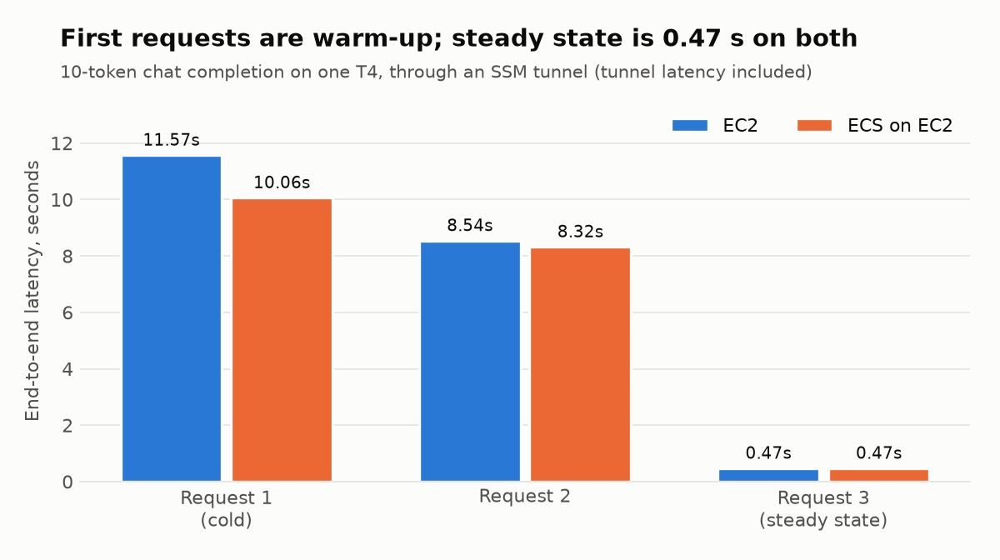
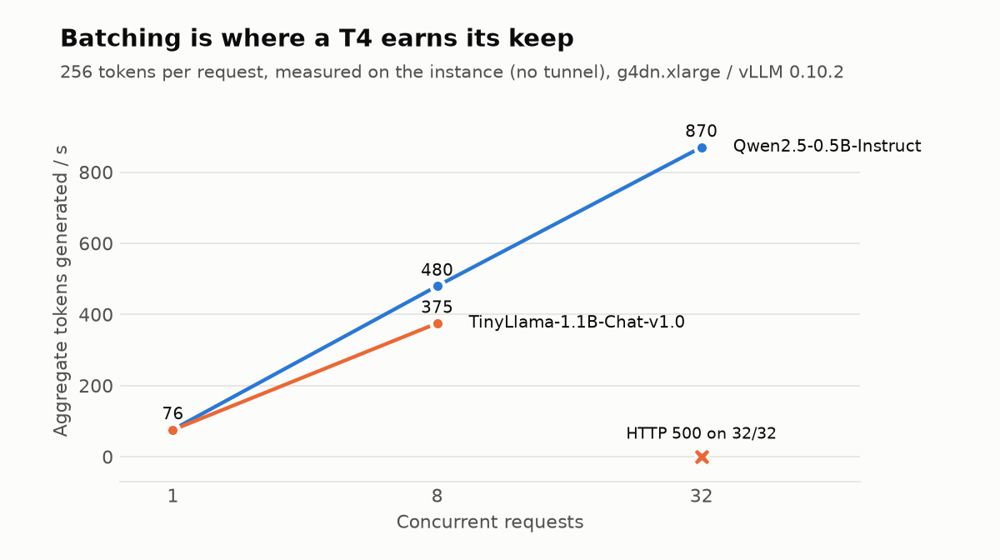
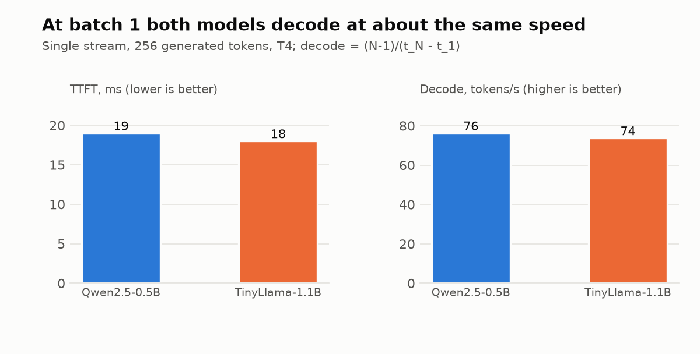
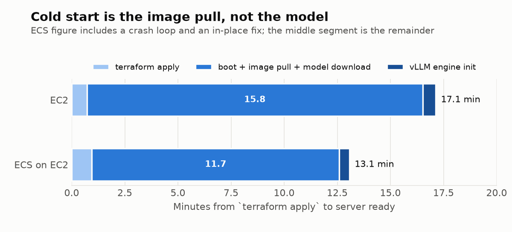

# Self-hosted tiny LLM on AWS: EC2 vs ECS-on-EC2 (GPU)

Run date: 2026-10-14 · Region: `us-east-1` · Account ID and instance IDs redacted.
Everything below was produced by `make e2e LAB=<lab>`; raw logs are in `runs/`.

## 1. Summary

| | **01-ec2** | **02-ecs-ec2** |
|---|---|---|
| Result | Serving, smoke test passed (3/3) | Serving, smoke test passed (3/3) |
| Steady-state latency (10 tokens) | 0.47 s | 0.47 s |
| Server ready after `apply` | ~16.5 min | ~12 min |
| What dominates readiness | Docker Hub pull of the ~20 GB vLLM image (~14 min) | same pull, but image was already cached on the host after an earlier in-place fix |
| Terraform resources | 5 | 15 |
| Destroy | 7.0 min (419 s) | 19.4 min (needed one manual intervention, see 5.6) |
| Recommendation | Quick experiments, single model, no self-healing needed | Anything you will leave running or roll forward: restarts, rollouts, logs |

**Bottom line:** both labs serve `Qwen/Qwen2.5-0.5B-Instruct` through vLLM's OpenAI-compatible API on one T4,
with identical request latency. They differ in operations, not performance. On this evidence the main cost
of either option is **cold start (image pull)**, not inference, and it is fixable by pre-baking an AMI or mirroring the
image to ECR.

Total spend for the whole session, including the failed attempts below and two benchmark runs, was roughly
**$1.40** of `g4dn.xlarge` on-demand time (~2.6 instance-hours at ~$0.53/h in us-east-1), plus negligible EBS.

**Throughput (measured on the instance, no tunnel):** Qwen2.5-0.5B decodes at **76 tok/s** on a single stream
with 19 ms to first token, and reaches **870 tok/s aggregate at 32 concurrent requests**. TinyLlama-1.1B decodes at
the same 74 tok/s single-stream but returned HTTP 500 on every request at concurrency 32 (cause not captured, see 5.8).

## 2. Setup

| Item | Value |
|---|---|
| Model | `Qwen/Qwen2.5-0.5B-Instruct` (pulled from Hugging Face at start) |
| Runtime | `vllm/vllm-openai:v0.10.2`, `--dtype half --max-model-len 2048` |
| Instance | `g4dn.xlarge` (1× NVIDIA T4 16 GB, 4 vCPU), on-demand |
| EC2 AMI | Deep Learning Base OSS Nvidia Driver GPU AMI (Ubuntu 22.04), resolved via SSM parameter |
| ECS AMI | ECS-optimized AL2023 GPU AMI, resolved via SSM parameter |
| Network | Own VPC + IGW + 1 public subnet per lab (see 5.1). No ingress; access via SSM port-forward |
| State | Local Terraform state, one directory per lab |
| Tests | `tests/smoke.sh`: `/health`, `/v1/models`, one chat call ×3, bash + curl |

Fargate was excluded because it has no GPU support.

### Architecture
- **01-ec2:** one instance; `user_data` runs `docker run --gpus all` with the vLLM image. IAM role only for SSM.
- **02-ecs-ec2:** ECS cluster; Auto Scaling group (1 instance) as capacity provider; one service, one task,
  `GPU=1`, bridge networking with `hostPort 8000`; CloudWatch log group via an execution role.

## 3. Results

### Test calls (same prompt, `temperature=0`, `max_tokens=32`)

| Run | 01-ec2 | 02-ecs-ec2 |
|---|---|---|
| 1 (cold) | 11.57 s | 10.06 s |
| 2 | 8.54 s | 8.32 s |
| 3 (steady) | **0.47 s** | **0.47 s** |



All responses were non-empty (10 tokens, the model ended the sentence early). Runs 1 and 2 are first-request
warm-up, so quote run 3 as steady state. Latency is end-to-end through the SSM tunnel, not server-side.
**Do not read these as tokens/s**: 10 tokens in 0.47 s is dominated by request overhead. Real decode speed is in
"Throughput benchmark" below (76 tok/s single stream, not the ~21 an earlier version of this table implied).

### Server-side (from `nvidia-smi` and the vLLM log)

| | 01-ec2 | 02-ecs-ec2 |
|---|---|---|
| GPU memory used | 12.6 GB / 15 GB | 12.7 GB / 15 GB |
| Engine init (profile, KV cache, warmup) | 36.8 s | 28.5 s |
| CUDA graph capture | 3 s | 3 s |

vLLM reserves ~12.6 GB of the T4 for a ~1 GB model because `gpu_memory_utilization` defaults to 0.9
(mostly pre-allocated KV cache). Lower it if you want to co-locate models.

### Throughput benchmark (`tests/bench.sh`, run on the instance)

Method: warm-up, then `max_tokens=1` for time to first token, `max_tokens=256` with `ignore_eos` for decode speed
(`(256-1)/(t256-t1)`), then 1, 8 and 32 concurrent requests (best of 2 rounds). Only HTTP 200 responses count.
Same instance type, vLLM 0.10.2, `--dtype half --max-model-len 2048`.

| | Qwen2.5-0.5B-Instruct | TinyLlama-1.1B-Chat-v1.0 |
|---|---|---|
| Time to first token | 19 ms | 18 ms |
| Single-stream decode | **76.2 tok/s** | **73.7 tok/s** |
| Aggregate, 1 request | 76.0 tok/s | 75.3 tok/s |
| Aggregate, 8 concurrent | 479.6 tok/s | 375.0 tok/s |
| Aggregate, 32 concurrent | **869.9 tok/s** | **HTTP 500 on 32/32** (2 rounds, 2 runs) |
| GPU memory in use | 14.0 GB | 14.0 GB |




Reading it:
- **Batch 1 is overhead-bound, not size-bound.** A model with 2.2x the parameters decodes at essentially the same
  rate, so per-step overhead (kernel launches, scheduling, 4 vCPUs) rather than weight bandwidth limits a single stream.
- **Batching is where the T4 pays off:** 11x aggregate throughput going from 1 to 32 requests on the small model.
  Under batching the larger model is slower (375 vs 480 at 8), as expected once compute and bandwidth matter.
- n = 1 instance per model. The TinyLlama 1/8-concurrency figures reproduced within ~2% across two separate runs
  (76.9 / 381.8 first run, 75.3 / 375.0 second).

### Timelines (UTC)



| Phase | 01-ec2 | 02-ecs-ec2 |
|---|---|---|
| `terraform apply` | 43 s | 57 s |
| Image pull + start | ~14 min | ~9 min (included a crash loop, see 5.3) |
| Server `/health` 200 | ~16.5 min after apply | ~12 min after apply |
| Destroy | 7.0 min (419 s) | 19.4 min |

**Caveat:** on 01-ec2 the harness reported `first health` at 1075 s because its SSM tunnel had gone stale; the
server itself was healthy about 90 s earlier. The server-side figure above uses the instance's own health check.
The 02-ecs-ec2 figure includes a crash loop and an in-place fix, so it is not a clean cold start.

## 4. Operational comparison

| Aspect | EC2 | ECS on EC2 |
|---|---|---|
| Moving parts | 1 instance, 1 role | cluster, ASG, capacity provider, task def, service, 2 roles, log group |
| Crash behaviour | `--restart always`; no health-based replacement | Service restarts the task; visible in events |
| Logs | `docker logs` via SSM | CloudWatch log group (set up in Terraform) |
| Rollout of a new image/model | Replace instance or SSH-style SSM edit | New task definition revision, service rolls (needed `min healthy 0` on 1 GPU) |
| Scale to N | Copy instances manually | Raise ASG and service count |
| Debuggability found this session | Cloud-init and console output | Task events + log group (this found the crash in minutes) |
| Destroy risk | Slow instance shutdown (5-8 min) | Extra ordering hazards (see 5.6) |

## 5. Issues hit and how they were resolved

| # | Symptom | Root cause | Fix |
|---|---|---|---|
| 5.1 | Instance running but SSM never registers; `docker pull` times out | The account's **default VPC route table pointed `0.0.0.0/0` at a deleted internet gateway** (`blackhole`) | Each lab creates its own VPC + IGW + route table |
| 5.2 | ECS apply failed: `When a network interface is provided, the security groups must be a part of it` | Launch template set the SG both at top level and in `network_interfaces` | Removed the top-level SG |
| 5.3 | vLLM container crash-loops during warmup: `TopPSamplingFromProbs failed ... too many resources requested for launch` | **FlashInfer top-p sampler kernel does not fit on a T4** (vLLM 0.10.2, compute capability 7.5) | `VLLM_USE_FLASHINFER_SAMPLER=0` (both labs) |
| 5.4 | ECS update rejected: AZ rebalancing does not support `maximumPercent <= 100` | Needed stop-then-start on a single GPU host | `availability_zone_rebalancing = "DISABLED"` |
| 5.5 | 01-ec2 timed out after 20 min with no health | Image pull alone took ~17 min; wait limit was too short | Wait limit raised to ~40 min |
| 5.6 | ECS destroy hung >12 min; service stuck `DRAINING` | Terraform removed the instance role's policies immediately, the ECS agent lost permissions and disconnected, one task never reported stopped, and managed draining blocked scale-in | Terminated the instance manually; config now makes the launch template/service depend on the attachments (validated, not re-tested) |
| 5.8 | **Unresolved:** TinyLlama-1.1B returns HTTP 500 for all 32 concurrent requests (Qwen 0.5B is fine at 32) | Not captured: the first occurrence was hidden by 5.9 and the instance was gone before logs could be read on the rerun. Plausibly another T4 kernel resource limit (same class as 5.3), but that is a guess | `bench-run.sh` now saves the server log automatically when requests error; one more run would settle it |
| 5.9 | First TinyLlama run reported an impossible 64,018 tok/s at concurrency 32 | `curl -f -w` still prints a time for HTTP errors and the script counted them as successes | `bench.sh` now records the status code and counts only 200s; the number was discarded |
| 5.7 | Harness reported health late on 01-ec2 | SSM port-forward session opened before the agent was ready and never recovered | Killed the session so it reopened; harness now recycles the tunnel every ~2 min while health is down |

Failed attempts are preserved in `runs/*-run0-*` and `runs/01-ec2-run1-timeout-20min/` as evidence.

## 6. Reproduce and tear down

```bash
# prerequisites: terraform, aws CLI + session-manager-plugin, EC2 "G and VT" on-demand vCPU quota >= 4 (8 for both labs)
export AWS_PROFILE=<profile> AWS_REGION=us-east-1
make e2e LAB=01-ec2          # apply, wait healthy, smoke x3, capture, destroy, leftovers
make e2e LAB=02-ecs-ec2      # run with PORT=8001 if running both at once
make leftovers               # tag-based sweep (lags a few minutes after deletes)
```

Teardown verification used in this session: Terraform state empty, instance `terminated`, no VPC tagged `lab=*`,
ECS cluster `INACTIVE`. The tagging API briefly lists terminated resources and inactive task definitions; those are not billable.

## 7. Recommendations and follow-ups

1. **Cut cold start:** pre-bake an AMI with the image, or mirror it to ECR in-region. Expect ~14 min → a few minutes.
2. **Pin and test the T4 workaround:** keep `VLLM_USE_FLASHINFER_SAMPLER=0`; re-test when moving vLLM versions or to an L4/A10G.
3. **Harness:** tunnel is now recycled every ~2 min while health is down (done, untested). Still to do: capture server-ready time from the instance, not through the tunnel.
4. **Re-test the ECS destroy ordering** to confirm 5.6 is fixed before relying on it.
5. **For anything beyond a lab:** add an ALB, TLS and auth, health-based replacement, deployment circuit breaker, and autoscaling. None of these were in scope.
6. **Decide on the default VPC:** the account's default VPC has no internet path; fix or remove it.

## 8. Caveats

- n = 1 instance per lab/model on a T4: indicative, not a rigorous benchmark.
- The smoke-test latency includes the SSM tunnel; the throughput benchmark does not.
- TinyLlama concurrency-32 failure is unexplained (5.8).
- Gemma 3 1B was considered and not used: it is gated on Hugging Face and Gemma 3 is unstable in fp16, which is all a T4 supports.
- 02-ecs-ec2 timings include a crash loop and an in-place fix.
- SageMaker HyperPod was scoped out (GPU quota for `ml.*` cluster usage was 0 in both regions probed, and it is a training-oriented product).
